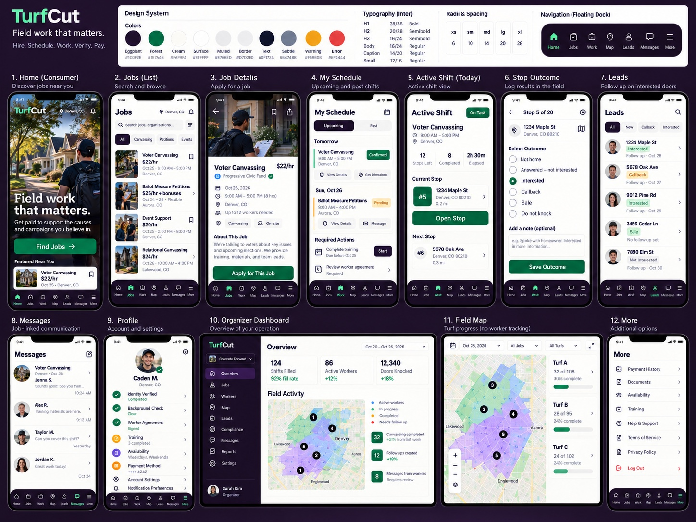

# TurfCut — current reference and corrective handoff

**Current design authority:** the founder's latest attached twelve-screen concept, preserved below without modification, and [issue #111](https://github.com/whiterican/TurfCut/issues/111). The founder asked for a repository audit and an improved plan for Claude, with faithful execution of this concept.

Read in this order:

1. [Corrective plan and source audit](CORRECTIVE_PLAN_2026-10-28.md).
2. [Exact tokens, dock, and responsive decisions](TOKENS_AND_NAVIGATION.md).
3. [Data replacements and feature boundaries](DATA_REPLACEMENTS.md).
4. [Twelve screen specifications](specs/README.md).
5. [Visual acceptance and evidence requirements](VISUAL_ACCEPTANCE.md).

The implementation audited is `redesign/hero-board` at `c0f8115bfa9fd0d4ce1e4a0297c491b944f668d5`. This package changes documentation only. It is an instruction and review package, **not evidence that the redesign is finished or approved**. The older 64-render handoff was rejected; old four-, five-, and six-tab directions and alternate font proposals are historical. Do not mix them into this reference.

The reference JPEG is the actual attachment from the founder's latest request, 1448 × 1086 pixels, SHA-256 `64964645a86bdd233c6fcd1b0ae78102851f8ef6c1cbdf5d342484c0799500b8`. It is a composite, not twelve full-resolution exports. It supplies the visual hierarchy and printed tokens; dimensions absent from it are explicitly proposed below. No missing per-screen images or static HTML files are claimed to have been delivered by this audit.

Keep existing authentication, grants, payment and audit behavior. Leads, per-address stop outcomes, and unsupported dashboard metrics do not become implemented features because they appear in the image. Their exact disposition is in the replacement matrix.
