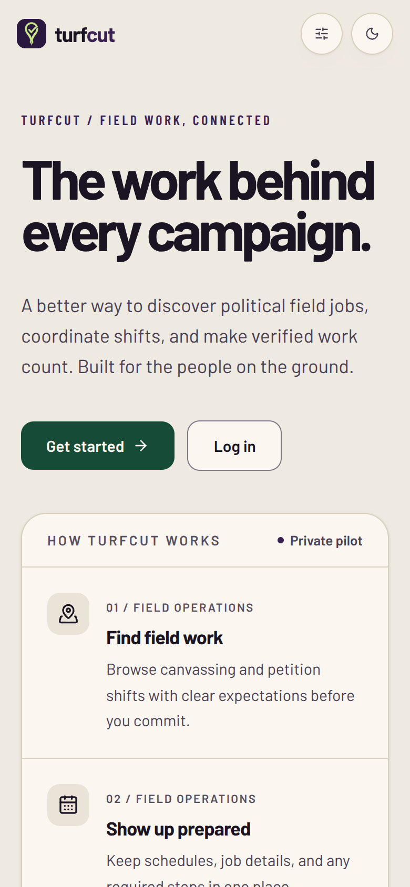

# Evidence from the repository audit

Source: `redesign/hero-board` at `c0f8115bfa9fd0d4ce1e4a0297c491b944f668d5`, reviewed 28 October 2026. No production app code or database records were changed.

- `npm ci` and `npm run db:generate` completed.
- `npm run typecheck` passed.
- `npm run lint` passed.
- `npm test`: **110 files, 948 tests passed**.
- Two real public `/` captures, light mode, device scale 2, HTTP 200; no horizontal document overflow at either tested width. Barlow loaded, body background computed as `rgb(239, 234, 225)` (`#EFEAE1`). These confirm the current appearance, not approval of it.

| Viewport | Current implementation |
|---|---|
| 390×844 CSS px | [public-home-390-light-before.png](public-home-390-light-before.png) |
| 1440×900 CSS px | [public-home-1440-light-before.png](public-home-1440-light-before.png) |

The public home shows a beige canvas, oversized text hero, two actions and a How TurfCut works panel; the reference shows a photographic entry and compact featured job. The public heading itself is Barlow; the separate finding about **operational** serif titles comes from `globals.css` and its tests. Do not conflate those two findings.

The [capture metadata](public-captures.json) records actual computed styles, dimensions and browser font statuses. `unloaded` entries include unused font weights/subsets; that is not evidence that the used Barlow face failed. These are local development screenshots and may include development UI, not production screenshots. The screenshot helper is not a newly shipped app dependency.

**Limits:** no authenticated test user/database session was available for the rest of the route inventory. No all-screen visual pass, dark/Sunlight pass, production build, real-device acceptance or separate Claude reviewer pass is claimed. Leads/Stop Outcome gaps were determined from the audited schema/routes, not from failed mock interactions. The original image attached to this package is the founder's actual latest upload, not a recreated mockup.
